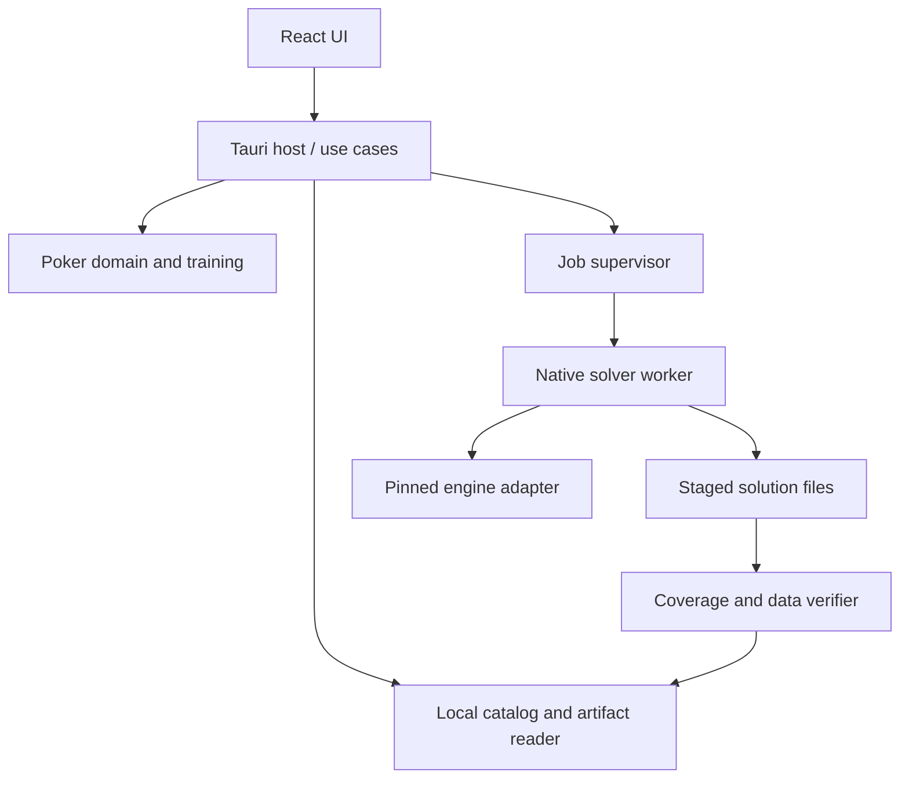

# Architecture v1

Status: selected design direction for implementation, 2026-10-30. Application code is
not implemented. Requirements remain in [requirements.md](requirements.md).

## 1. Decisions and alternatives

| Decision | Reason | Cost / revisit condition |
| --- | --- | --- |
| Tauri 2 + React/TypeScript UI | Native packaging with a web-based range grid and charts; reuse one UI on Windows/macOS | Rust and platform build tooling; verify WebView behavior on both systems |
| Rust owns domain and application services | One authoritative implementation of poker rules, evaluation conventions, and session state | UI bindings must be generated and tested |
| Separate native solver process | Contain native failures, bound memory, cancel long jobs, replace engines | Versioned IPC and artifact conversion required |
| Local modular application, no HTTP backend | Matches independent local use; no accounts or service operations | Remote workers would need a later transport adapter |
| SQLite for metadata; indexed binary files for large arrays | Query training records without loading a solver tree | Atomic publication spans filesystem and database |
| CPU baseline, optional acceleration later | Windows and Mac machines including 8 GB must remain useful | Heavy solves may require smaller configurations or imported results |
| Upstream solver behind an adapter | Reuse mature computation while retaining ownership of product semantics | Integration tests and a maintained fork may be required |

Electron would simplify a JavaScript-only desktop host, but adds an embedded browser
runtime alongside already memory-heavy solving. Browser/WASM-only execution is useful
for a future viewer, but is not the first compute target. A Python service would add a
third production runtime without a current requirement. These are design tradeoffs,
not measured performance conclusions.

## 2. Process and ownership boundaries

The UI receives a restricted training view until a hand is over. The host owns session
state and opponent cards. UI code cannot spawn processes, read arbitrary files, invoke
an engine, or bypass the training visibility rules. Native user access to local files
is not an anti-cheating threat model; this separation prevents accidental spoilers.

The worker owns engine memory. Its stdout carries protocol messages; stderr carries
bounded diagnostics. Large strategy arrays never travel as one JSON message. The
supervisor allows one heavy computation at a time by default. Analysis/training reads
are separately budgeted; training reserves resources before a new solve is admitted.

## 3. Planned code ownership (create when implemented)

| Path | Owns | Must not own |
| --- | --- | --- |
| apps/desktop/src/features/scenarios | Scenario form, range editor, validation display | Poker rule authority |
| apps/desktop/src/features/opponents | Tendency controls and concrete policy inspection | Engine-native nodelock calls |
| apps/desktop/src/features/study | Range grid, values, comparisons, filters | EV calculations |
| apps/desktop/src/features/training | Table view, actions, post-hand review | Opponent hidden state |
| apps/desktop/src/features/jobs | Progress, resource estimates, resume controls | Task scheduling logic |
| apps/desktop/src/i18n | English default and Chinese translations | Duplicated business messages |
| apps/desktop/src-tauri | Platform commands, dialogs, process lifecycle | Solver algorithms |
| crates/poker-domain | Cards, weighted ranges, legal actions, chip ledger, terminal rules | UI/SQL/engine dependencies |
| crates/application | Scenario revisions, analysis/training use cases, ports | Direct third-party solver calls |
| crates/opponent-model | Deterministic tendency compilation and explicit locks | Opponent fitting from private history |
| crates/solver-api | Capabilities, jobs, engine-neutral input/output, failure types | Choice of solver |
| crates/solver-worker | Worker protocol, solve/evaluation/export task orchestration | Desktop sessions |
| crates/engine-postflop | Pinned engine translation and audited patches | Application persistence format |
| crates/solution-store | Indexed arrays, bounded readers, checksums, portable export | Optimization state |
| crates/catalog | SQLite metadata, migrations, session transactions | Multi-GB numerical arrays |
| contracts | Reviewed wire definitions and conformance vectors | Duplicate production poker engine |
| tests/fixtures | Synthetic reference games and permitted data with provenance | Unattributed commercial solutions |
| benchmarks | Reproducible workloads, machine metadata, result comparisons | Marketing-only timings |

Application modules depend on ports, not concrete adapters. Rust domain and contract
crates have no dependency on Tauri. Engine adapter failures translate into stable
application errors; vendor panics and indices must not leak into UI contracts.

## 4. First vertical slice

1. Validate a scenario; freeze a revision and computation identity.
2. Query capabilities and preflight memory/disk. Reject unsupported semantics explicitly.
3. Solve a bounded reference tree, compile an opponent, evaluate best response and
   chosen deviation settings, perform supported sizing search, then evaluate the final tree.
4. Export all supported future-board/action branches and necessary evaluation arrays.
5. Verify the staged artifact independently, then atomically publish it.
6. Create a training session bound to this immutable artifact and evaluation objective.
7. Sample legal deals, advance saved policies, and record actions without computation jobs.
8. Reveal post-hand review and update statistics transactionally.

Changing a range, model, size, rake rule, or evaluation objective creates a new revision;
it never mutates the artifact underneath an ongoing session. Changing the deviation
level selects another precomputed profile or requests preparation before a new session.

## 5. Resource policy

An 8 GB machine is a supported training/import target, not an 8 GB solver allocation.
Provisional worker budget: min(user limit, 45% of physical RAM, available RAM minus
1.5 GiB reserve). Refuse a heavy job if the resulting budget is below its preflight
requirement. Defaults need validation on target machines, and remain adjustable.

Budget includes node topology, regret/strategy storage, thread scratch space, showdown
tables, export buffers, and any decompression. Upstream memory_usage alone is not peak
RSS. Preflight itself must be bounded; use a counting pass before constructing a giant
tree. Avoid simultaneously keeping a reference tree, all candidate trees, and a
response tree in memory. Candidates run sequentially and publish intermediate results.

The result reader uses bounded chunk caching (initial target 128 MiB), query-sized
arrays, and bounded prefetch. A blocked OS read is not a solve, but is still covered by
latency benchmarks. Do not expand the full portable archive into RAM. Keep enough disk
for staged output plus checkpoint and an existing valid artifact.

## 6. Persistence, compatibility, and installation

Use an application-owned data directory. Store local catalog entries, immutable
scenario revisions, job state, session records, and indexed artifacts. Export a
portable package with source/version metadata, checksums, and selected content; omit
training history by default. No login, cloud synchronization, or telemetry is required.

Publish staged files on the same filesystem as the destination: flush, validate,
rename, then commit a catalog transaction. On restart, reconcile orphaned completed
artifacts and abandoned staging directories without deleting user originals. Import
enforces path containment, size limits, format versions, checksums, and semantic
validation; checksums alone do not prove numerical validity.

Preserve old result readers during format migrations; never overwrite the only copy.
Compute artifacts identify engine revision and patches, while portable training reads
must not require reinstalling an old unsafe vendor decoder. Resuming a checkpoint may
require the exact engine build; reading a portable result should not.

Package separately for Windows x64, macOS arm64, and macOS x64. These are initial build
targets, not tested platforms today. Signing/notarization and minimum OS versions are
release tasks. Manual versioned installers are sufficient initially; automatic client
updates were not a user requirement. CI does not automatically publish releases.

## 7. Decision log

- A01: local desktop + isolated worker, selected now; revisit after M0 integration evidence.
- A02: Rust authoritative domain and generated frontend bindings; current TypeScript
  interfaces are a review specification, not an additional production rule engine.
- A03: immutable trainable artifacts independent of engine checkpoint formats.
- A04: first evaluate b-inary/postflop-solver; selection is conditional on semantic,
  licensing, checkpoint, and platform gates, not a permanent engine commitment.
- A05: no neural value network, GPU dependency, or multi-player solver in the first slice.

Primary framework references: [Tauri process model](https://v2.tauri.app/concept/process-model/),
[native sidecars](https://v2.tauri.app/develop/sidecar/), and
[testing support](https://v2.tauri.app/develop/tests/). Exact framework/tool versions are
pinned in lockfiles when the desktop workspace is introduced, not invented here.
