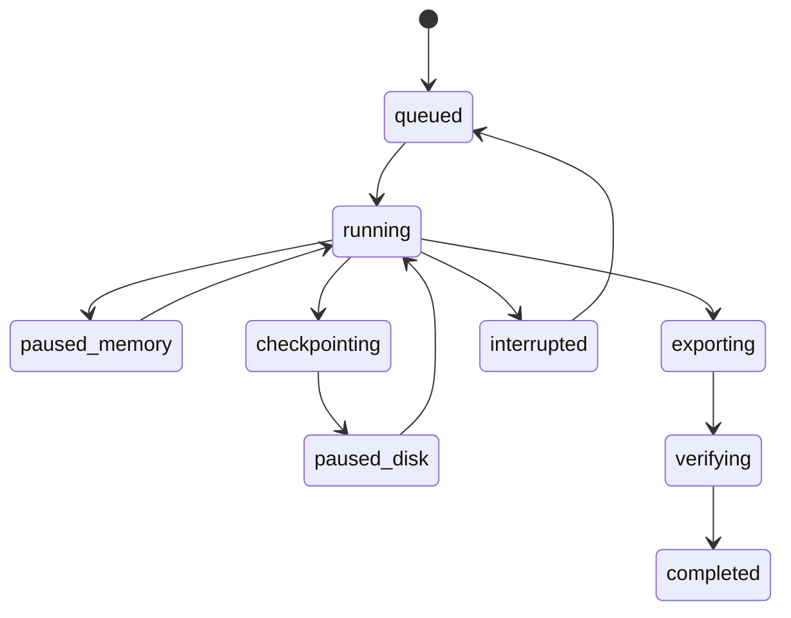

# Protocol and persistence contracts

Version: v1 draft. [TypeScript interfaces](../contracts/v1.ts) are a reviewed design
specification. Implement strict runtime decoders and generate bindings in M0; these
types alone do not validate JSON or imported files.

## Identifiers and revisions

Use immutable scenario revisions and content-derived computation identities. The
canonical input includes normalized ranges, board and positions, ledger/rake rules,
realized action tree, compiler version and concrete opponent policy, objective, hero
seat, alpha, stopping settings, precision, bunching assumption, engine revision/patches,
and relevant algorithm parameters. UI names, language, filesystem locations, training
session IDs, and the record's own revision/digest fields are excluded. Cache matching
never uses only flop and stack; self-identifiers are not recursively hashed.

Resolve the preparation DAG in order: problem -> reference tree/baseline -> compiled
opponent -> response/evaluation -> candidate/final tree -> final policies/values ->
portable artifact. A request ID identifies intent; an artifact hash identifies its
fully resolved computation. Tree changes invalidate compiled policy bindings. There
is no circular hash between a request and a result it has not produced.

Canonical JSON uses sorted object keys, preserved array order, finite numbers, and
safe integer amounts. Normalize ranges and action ordering before hashing. The small
reference helper is tested for these rules; production cross-language encoders require
shared vectors including float edge cases and must avoid implicit locale formatting.

## Application commands (Tauri boundary)

| Command | Input | Output / invariant |
| --- | --- | --- |
| validate_scenario | Draft scenario | Field errors, normalization report, canonical revision preview |
| save_scenario | Draft + expected revision | New immutable revision; stale writes conflict |
| preview_opponent | Revision + rules + baseline ID | Affected nodes/combos, policy diff, errors |
| preflight | Preparation request | Capabilities, peak memory/disk estimates, supported quality targets |
| enqueue_preparation | Frozen request + idempotency key | Job ID; repeated identical request does not duplicate work |
| control_job | Job ID + expected revision + action | New state or structured unsupported/conflict error |
| inspect_solution | Artifact ID | Coverage, model, precision, ready state |
| query_node | Artifact + profile + semantic history + perspective | Paged range/strategy/EV views with units and validity |
| start_training | Verified artifact + profile + sampling config | Restricted session view; no hidden cards or Q values |
| act | Session + expected sequence + action ID | Next restricted view or completed hand; replay-safe |
| review_hand | Completed hand ID | Full hand and comparisons for its fixed artifact/profile |
| export_package / import_package | Selected content / file handle | Validated portable package; no user-provided executable path |

Use stable error codes: INVALID_SCENARIO, ZERO_JOINT_MASS, UNSUPPORTED_CAPABILITY,
MODEL_TREE_MISMATCH, RESOURCE_LIMIT, INCOMPLETE_COVERAGE, UNDEFINED_VALUE,
STALE_REVISION, CHECKPOINT_INCOMPATIBLE, CORRUPT_ARTIFACT, ENGINE_CRASH.
Render localized messages separately; logs carry safe structured diagnostics.

## Worker protocol

Private stdin/stdout channel, newline-delimited UTF-8 JSON control messages. Envelope
contains protocol version, request/job IDs, monotonic sequence, type, and payload.
Require a hello/capabilities exchange before work. Limit individual control frames
initially to 1 MiB; large inputs/outputs use host-assigned staging handles and bounded
binary files, never unrestricted paths from the UI. Worker stderr is not protocol data.

Commands: hello, estimate, prepare, pause, checkpoint, resume, cancel, shutdown.
Events: capabilities, accepted, phase, progress, checkpoint_saved, artifact_staged,
failed, cancelled. Every terminal event is idempotently handled. Progress reports
phase-specific counters and elapsed time; do not manufacture a total percent when
search work is unknown. Sparse heartbeats allow crash/hang diagnosis, not optimistic
completion. Reject unknown versions and invalid transitions.

Capabilities distinguish fixed-opponent locking, exact best response, rake variants,
arbitrary suit locks, estimates, full-depth export, in-memory pause, and durable optimizer
resume. They start false until adapter conformance tests establish them. Missing
capabilities are rejected at preflight, not worked around invisibly.

## Job lifecycle

Error and cancel edges omitted from the diagram for readability; the executable
transition table includes them. State changes use expected revision and append an
event. Only the host verifier may move verifying to completed. Completion of a job
does not by itself certify solver accuracy. A child process exit without a terminal
event becomes interrupted/failed, not completed.

Pause-in-memory retains RAM. Disk pause requires an acknowledged complete checkpoint
and releases memory only after successful publication. Cancellation waits for a
cooperative boundary, then may terminate after a grace interval; it must not report
checkpoint success before files are committed. A resumed interrupted job requires a
validated checkpoint or is clearly restarted from zero.

## Three independent result properties

1. Computational status: completed, budget-exhausted, cancelled, or failed.
2. Coverage: all offered hero actions, supported opponent actions, and every legal
   public-card continuation through terminal states, including hero deviations from
   zero-frequency baseline actions where the counterfactual value is meaningful.
3. Quality: metric name/definition, value, units, deviation space, estimates/bounds,
   and whether the requested target was met.

Only a complete, validated artifact with applicable values can start normal training.
Approximate-quality training may be an explicitly selected mode; it cannot rescue
missing branches. Synthetic test fixtures never qualify as normal GTO training data.

An export records the actual tree and a coverage report produced by traversing all
represented nodes and chance-equivalence classes. Checking that expected_count equals
stored_count is necessary but not sufficient: validate edge targets, card legality,
strategy normalization, data references, semantic mappings, and content digests.
The reference gate tests consume a verifier result; they do not implement that traversal.

## Portable artifact format

Initial design: versioned manifest JSON plus binary chunks and indexes inside a portable
archive. On import, validate and unpack to the local immutable store. Runtime uses
indexed files, not archive random access. Specify little-endian arrays and offsets,
checksums, units, card ordering, compression version, and maximum decompressed sizes.

| File / logical record | Content |
| --- | --- |
| manifest.json | Schema version, computation identity, provenance, platform-independent metadata, verification evidence |
| problem.json | Canonical ranges, initial public state, rules and unit conventions |
| tree/index | Semantic node/action IDs, chance transitions, suit mappings, terminal ledger references |
| policies/chunks | Ordered combo IDs and action-major probabilities for baseline/model/response profiles |
| values/chunks | Per-profile Q/equity/range data and validity masks; distinguish undefined values |
| coverage.json | Exhaustive coverage claims with verifier version and actual checked scope |
| provenance.json | Engine revision, patches, source datasets, algorithm settings and precision |

Optimizer checkpoints are separate, version-bound artifacts; do not put native pointers
or raw memory dumps into the portable format. Native result files can be imported only
through a bounded adapter converter, not opened as trusted application storage.

## Catalog entities

scenario -> immutable scenario_revision; opponent_definition -> opponent_revision;
preparation_job -> job_event/checkpoint; solution -> evaluation_profile/coverage_report;
training_session -> training_hand -> decision; source_dataset -> source_revision.

Foreign keys preserve which exact strategy and opponent were used for every decision.
Session actions carry monotonically increasing sequence numbers and persist atomically
with the updated session. Store natural vs targeted sampling and RNG algorithm/version.
Seed replay is versioned, not assumed identical across languages or future RNG updates.

## Zero-reach and import errors

Represent undefined values explicitly, including reason, never as NaN or zero. Import
rejects nonfinite values, malformed probability rows, unsupported future versions,
oversized allocation claims, duplicate IDs, invalid offsets, path traversal, and hash
mismatch. Unknown optional metadata can be preserved by version policy; unknown
semantics affecting play cannot be ignored.
